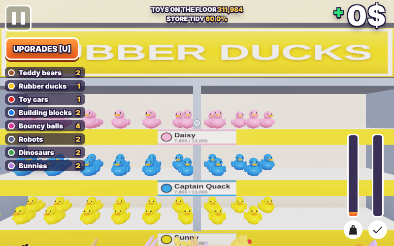
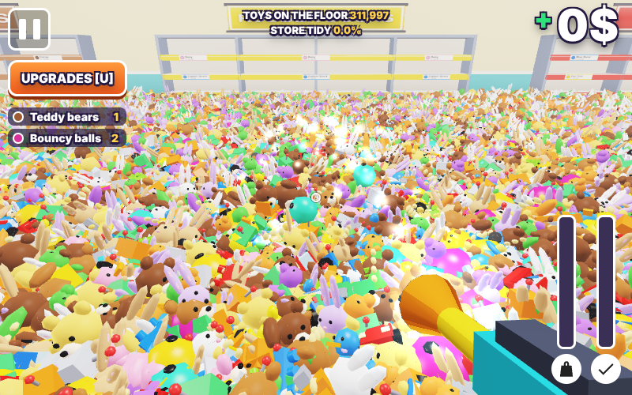
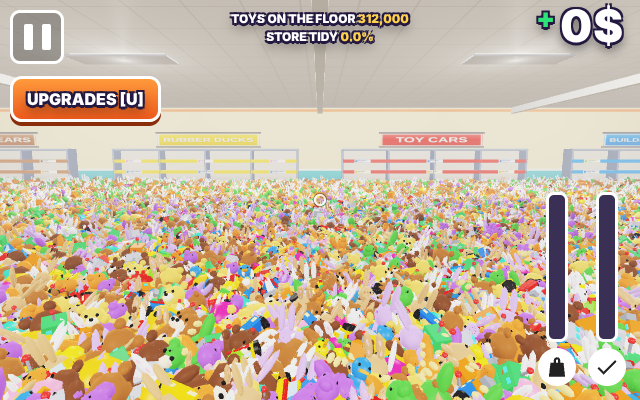

# Toy Town — Tidy-Up

**312,000 toys. One messy store. One mission: put every toy back where it belongs.**

Toy Town — Tidy-Up is a first-person 3D cleaning game built with vanilla HTML, CSS, JavaScript, and WebGL2. Explore a toy store buried under hundreds of thousands of scattered toys, vacuum them up, carry them to their matching shelves, earn money, and upgrade your equipment until the entire store is spotless.

The game is designed as a lightweight, zero-dependency browser experience, with a custom WebGL2 renderer and controls for both desktop and touchscreen devices.

[Overview](#overview) · [Features](#features) · [Preview](#preview) · [Live Demo](#live-demo) · [Tech Stack](#tech-stack) · [Quick Start](#quick-start) · [Controls](#controls) · [Toy Categories](#toy-categories) · [Project Structure](#project-structure) · [Rendering & Performance](#rendering--performance) · [Development](#development) · [Compatibility](#compatibility) · [License](#license) · [Contact](#contact)

## Overview

**Toy Town — Tidy-Up** is a first-person cleaning game with one big objective: restore a toy store covered by **312,000 toys**.

Move around the store with your vacuum cleaner, collect toys from the floor, and bring them to the shelf displaying the matching category. Every toy you successfully stock earns money, which can be spent on upgrades to make cleaning faster and easier.

The store contains eight toy categories, each with three collectible toy variants. The shelves display live stock counters, helping you keep track of what still needs to be collected. Complete the challenge by returning every toy to its correct shelf and reaching the **STORE PERFECT!** victory screen.

The project uses a custom WebGL2 rendering pipeline, procedural geometry and textures, and JavaScript gameplay systems. No external frameworks, npm packages, or build tools are required.

## Features

- **First-Person 3D Gameplay** — Explore the toy store from an immersive first-person perspective.
- **312,000 Scattered Toys** — Clean up a huge store filled with a large variety of toys.
- **Vacuum Cleaner Mechanics** — Hold the vacuum control to collect toys from the floor.
- **Eight Toy Categories** — Find teddy bears, rubber ducks, toy cars, building blocks, bouncy balls, robots, dinosaurs, and bunnies.
- **24 Toy Variants** — Each category includes three individual toy variations.
- **Matching Shelves** — Carry collected toys to the correct category shelf and stock them.
- **Money System** — Earn money every time you successfully put toys back on the shelves.
- **Equipment Upgrades** — Improve vacuum power, suction reach, toy bag capacity, and movement speed.
- **Live Progress Tracking** — Monitor remaining toys, collected items, money, bag capacity, and store tidiness.
- **Dynamic Interactions** — See collected toys fly toward the player and onto the shelves.
- **Procedural 3D Environment** — Geometry, textures, shelf labels, and visual details are generated by the game.
- **Sound Effects** — Procedurally generated audio feedback for vacuuming, collecting, purchases, and completing the game.
- **Responsive Interface** — HUD, menus, upgrade screen, pause screen, and victory screen.
- **Desktop and Mobile Controls** — Play with keyboard and mouse or touchscreen controls.
- **Zero Dependencies** — Built with native web technologies, without external libraries or packages.

## Preview

<p align="left">
  
  
  
</p>

**Live Demo:** https://nowii-core.github.io/toystore/toystore/

## Tech Stack

| Technology | Purpose |
| :--- | :--- |
| **HTML5** | Game structure, interface, menus, and WebGL canvas |
| **CSS3** | HUD, menus, responsive layout, and touch controls |
| **JavaScript (ES6+)** | Game engine, input handling, gameplay systems, and procedural generation |
| **WebGL2** | Custom 3D rendering pipeline, shaders, lighting, and GPU-accelerated drawing |
| **Canvas API** | Procedural texture and label generation |
| **Web Audio API** | Generated sound effects and audio feedback |

**Dependencies:** None.

**Build tools:** None required.

**Rendering requirement:** WebGL2 support is required to play.

## Quick Start

### Requirements

- A modern web browser with WebGL2 support.
- Keyboard and mouse for desktop gameplay, or a touchscreen device for mobile gameplay.
- A local web server for the recommended development setup.

### Run Locally

1. **Clone the repository:**

   ```bash
   git clone https://github.com/nowii-core/toystore.git
   ```

2. **Open the game subdirectory:**

   ```bash
   cd toystore/toystore
   ```

3. **Start a local server:**

   ```bash
   python3 -m http.server 8000
   ```

4. **Open the game in your browser:**

   ```text
   http://localhost:8000
   ```

You can also open `index.html` directly in a modern browser. Using a local server is recommended while developing and testing.

No package installation, compilation, or build process is needed.

## Controls

### Desktop

| Action | Control |
| :--- | :--- |
| Move | `W` `A` `S` `D` or Arrow Keys |
| Look around | Mouse |
| Vacuum toys | Hold Left Mouse Button |
| Stock toys on a shelf | `E` |
| Run | Hold `Shift` |
| Open / close upgrades | `U` |
| Pause | `P` or `Esc` |

### Mobile

| Action | Control |
| :--- | :--- |
| Move | Virtual joystick |
| Look around | Touch and drag on the game view |
| Vacuum toys | Hold **VACUUM** |
| Stock toys on a shelf | **E** button |
| Open upgrades | **UPGRADES** button |
| Pause | Pause button |

## Toy Categories

The store features eight categories, each with three toy variants:

| Category | Toy Variants |
| :--- | :--- |
| Teddy Bears | Barnaby, Honey, Cocoa |
| Rubber Ducks | Sunny, Captain Quack, Daisy |
| Toy Cars | Speedy, Taxi Tom, Blue Racer |
| Building Blocks | Classic Red, Ocean Blue, Lime Brick |
| Bouncy Balls | Sunburst, Berry Pop, Minty |
| Robots | Bolt, Gizmo, Max |
| Dinosaurs | Rexy, Spike, Stego |
| Bunnies | Snowball, Peanut, Lilac |

Bring each toy to the shelf that matches its category. Stocking toys earns money and increases the store tidiness percentage.

## Upgrade System

Use the money earned from stocking toys to improve four pieces of equipment:

- **Vacuum Power** — Collect more toys per second.
- **Suction Reach** — Vacuum toys from a wider area.
- **Toy Bag** — Carry more toys before returning to a shelf.
- **Sneakers** — Move around the store faster.

Choose upgrades strategically to make each cleaning trip more efficient.

## Project Structure

The repository keeps the game inside the `toystore/` subdirectory. The preview images are stored in the repository root, one level above the README.

```text
toystore/                      # GitHub repository root
├── toystore1.png              # Preview screenshot 1
├── toystore2.png              # Preview screenshot 2
├── toystore3.png              # Preview screenshot 3
└── toystore/                  # Game subdirectory
    ├── index.html             # Main game page and interface
    ├── style.css              # Styling, HUD, menus, and touch layout
    ├── script.js              # WebGL2 renderer and game logic
    ├── README.md              # Project documentation
    └── LICENSE                # MIT License
```

## Rendering & Performance

Toy Town uses a custom WebGL2 renderer to display its large toy-filled environment.

- The game generates **312,000 toy instances** through JavaScript.
- Toy meshes are drawn using GPU instancing.
- Toys are organized spatially to support efficient visibility and collection queries.
- Distance-based level of detail and visibility checks help reduce unnecessary rendering work.
- Procedural textures and shelf labels are generated in the browser.
- The rendering resolution can adapt to device performance, with additional quality adjustments for touch devices.

Actual performance depends on the browser, device, and graphics hardware.

## Development

The project is intentionally split into three main files, making it easy to modify without a build system.

### Recommended Workflow

1. Clone the repository.
2. Open the `toystore/` game subdirectory in your code editor.
3. Start a local development server.
4. Edit the HTML, CSS, or JavaScript files.
5. Refresh the browser and test your changes.
6. Check both desktop and mobile controls when changing gameplay or interface behavior.

### Customize the Game

- **Game Structure:** Edit `index.html` to change the page structure, menus, HUD elements, or interface text.
- **Visual Design:** Edit `style.css` to customize colors, typography, layout, and responsive behavior.
- **Gameplay & Rendering:** Edit `script.js` to modify toy generation, vacuum mechanics, upgrades, movement, WebGL2 rendering, and game logic.

## Compatibility

Toy Town requires a browser with **WebGL2** support. It is designed for modern desktop and mobile browsers.

Desktop gameplay uses keyboard and mouse input. Touchscreen devices use an on-screen joystick, touch camera movement, and dedicated action buttons. Performance may vary depending on the device's graphics hardware and browser implementation.

## License

This project is distributed under the **MIT License**. See the [LICENSE](LICENSE) file for the full license text.

## Contact

- **Developer:** [@nowii-core](https://github.com/nowii-core)
- **Repository:** [nowii-core/toystore](https://github.com/nowii-core/toystore)
- **Issues & Suggestions:** [Open an issue](https://github.com/nowii-core/toystore/issues)

---

<p align="center">
  <sub>Designed and developed by <a href="https://github.com/nowii-core"><b>nowii-core</b></a></sub>
</p>
